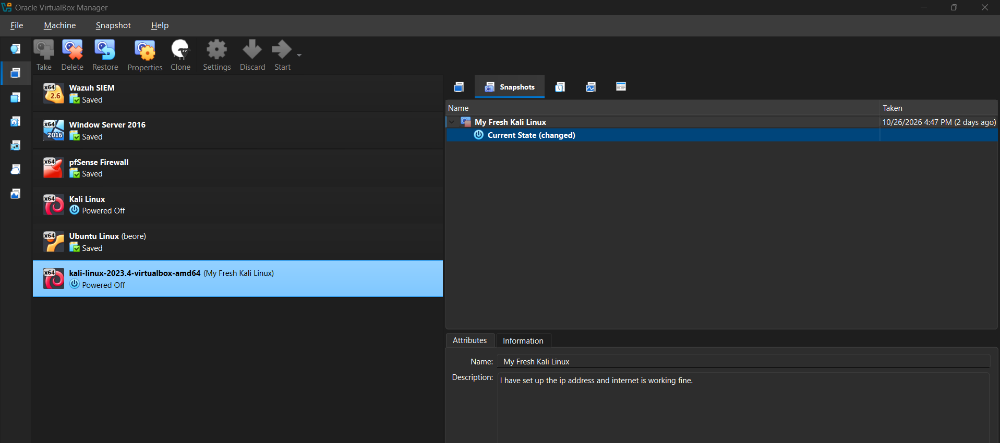
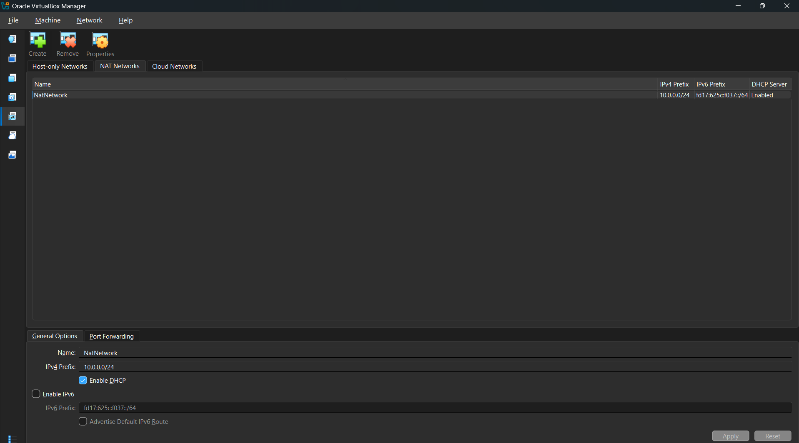
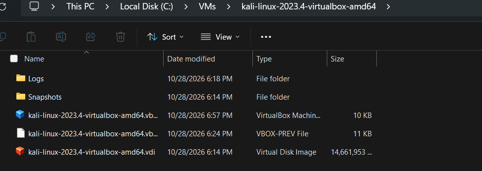
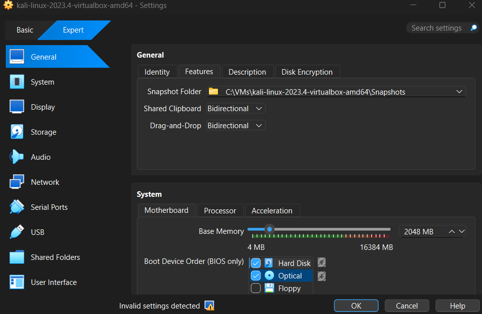
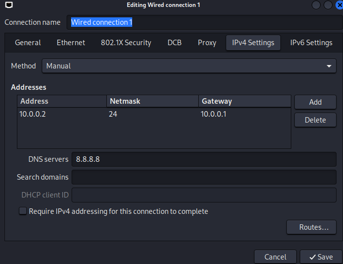
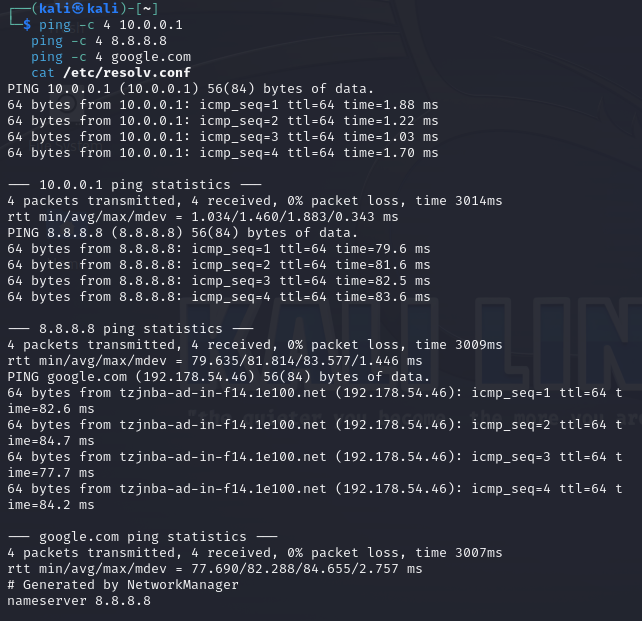
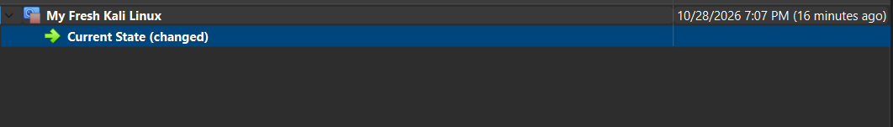

# 🔐 Cybersecurity Lab Setup

**NetworkWalks Cybersecurity Program – Week 1 (PM1) | Batch B084C | GOLD**

An isolated VirtualBox lab with Kali Linux for ethical hacking practice.

> ⚠️ For education only. Everything is done on my own machine and my own lab network.

---

## 🖥️ Setup

| Item | Detail |
|------|--------|
| Host | Windows 11, 16 GB RAM, NVMe SSD, AMD CPU |
| VirtualBox | (add version) |
| Kali Linux | 2023.4 (pre-built VirtualBox image) |
| Network | NAT Network `NatNetwork`, `10.0.0.0/24`, DHCP on |
| Kali IP | `10.0.0.2/24` (static), gateway `10.0.0.1`, DNS `8.8.8.8` |

---

## 🛠️ Steps

1. **Installed 7-Zip and VirtualBox** (default options).
   
2. **Created the NAT Network:** `File → Tools → Network → NAT Networks`, name `NatNetwork`, prefix `10.0.0.0/24`, DHCP enabled.
   
3. **Imported Kali Linux** from kali.org/get-kali and extracted it with 7-Zip.
   
4. **Configured the VM:** Adapter 1 on `NAT Network`, Shared Clipboard and Drag'n'Drop set to `Bidirectional`, host `Downloads` folder shared (Auto-mount, Full access).
   
5. **Set the static IP** in Edit Connections → IPv4 → Manual: `10.0.0.2`, netmask `24`, gateway `10.0.0.1`, DNS `8.8.8.8`.
   
6. **Tested:** `ip a`, `ping 10.0.0.1`, `ping 8.8.8.8`, `ping google.com`.
   
7. **Took a snapshot:** `My Fresh Kali Linux`.
   

---

## 🧩 Troubleshooting

**Problem:** `ping 8.8.8.8` worked but `ping google.com` failed ("Temporary failure in name resolution").

**Cause:** `/etc/resolv.conf` pointed to `10.0.0.1`, which was not answering DNS queries.

**Fix:** Set DNS to `8.8.8.8` in the connection settings, then:
```bash
sudo nmcli connection modify "Wired connection 1" ipv4.dad-timeout 0
sudo nmcli connection down "Wired connection 1"
sudo nmcli connection up "Wired connection 1"
```
`resolv.conf` then showed `8.8.8.8` and `ping google.com` had 0% loss.

**Also:** my VM was first stored in OneDrive, which can cause sync problems. I moved it to `C:\VMs\`.

---

## ✅ Result

Kali runs on `10.0.0.0/24` with IP `10.0.0.2/24`, full Internet access, working clipboard, drag & drop and shared folder, and a clean snapshot.

## 📚 What I Learned

- If pings to an IP work but names fail, the problem is DNS, not routing.
- Snapshots make it easy to restore a clean lab.
- A NAT Network keeps lab machines together while still allowing Internet access.
